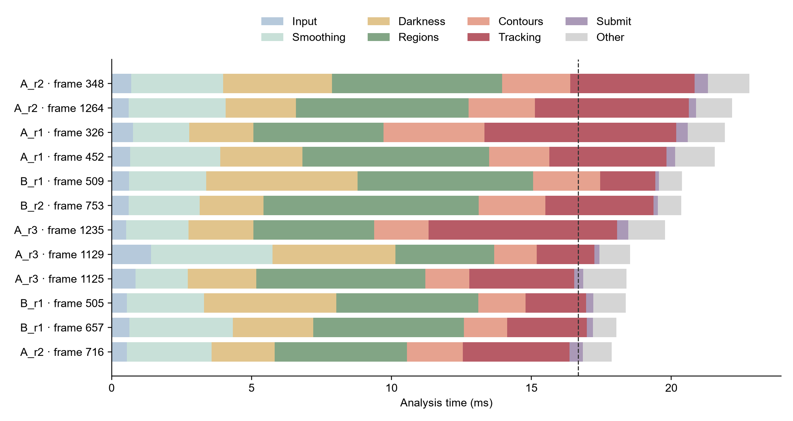

# 分析内部偶发慢帧：本轮结论

本轮已经定位到慢帧具体耗在哪一步。**主要增加的是区域筛选、暗度计算和追踪中的形状计算时间；保存提交没有发生十几毫秒的等待。** 同一批画面、同样的处理顺序和时间信息重新计算后，全部 17 个诊断慢帧的核心计算都回到 7.659–10.557 ms，结果完全一致。因此，不能把这些慢帧解释为画面本身必然需要二十多毫秒。

但本轮**没有证明全部慢帧都由某一个后台程序引起**。Windows 记录显示部分慢帧附近存在明显的后台 CPU 活动及 WSL 线程等待；函数采样同时显示分析线程仍在执行数组计算和区域处理。当前证据支持“实际计算阶段的运行速度波动，部分叠加目标数量变化”，不能进一步把每一毫秒唯一分给 CPU 调度、频率变化或缓存/内存争用。

## 1. 实际怎样测试

- 使用 F 盘已搭建的 A、B RTSP 模拟相机，经原 Windows 接收、录像、管道及 WSL 分析流程；每组 22 秒，始终保留 **1 帧等待区**、24 个 OpenCV 线程。
- A/B 各做一次不开分析分项的对照，再各做三次分项诊断。最后一轮另加 Linux 函数采样和限时 Windows 系统记录。没有连接真实相机或 PZT。
- 没有修改识别、追踪、图像转换、保存算法或正式设备配置。详见 [前后文件哈希](after_sha256.json)。系统记录已停止，模拟发送程序已收尾，没有暂停其他软件或改变 Windows/WSL 设置。
- 普通对照分析中位数为 A **8.758 ms**、B **8.554 ms**。开启诊断的六轮为 **9.071–9.518 ms**；其中包含诊断负担及轮次波动，不能当作新算法性能。
- 六轮诊断分析 7,904 帧，其中 **17 帧超过 16.67 ms**，最慢 **22.820 ms**。本次没有重现原来的 36 ms 首帧，不能用本轮数据倒推那一帧的具体原因。

完整八轮统计和每个慢帧见 [分项报告](report/REPORT.md)。本轮只是短时诊断，不是长时间稳定性验收。

## 2. 时间具体花在哪里

以下“通常”是六轮各自中位数的范围；最大值来自全部诊断帧，**各行最大值并非发生在同一帧，不能相加**。

| 步骤 | 通常耗时 ms | 本轮最大 ms |
| --- | ---: | ---: |
| 图像平滑 | 1.48–1.50 | 5.14 |
| 相对暗度计算 | 1.29–1.32 | 5.41 |
| 区域识别与筛选 | 2.44–2.56 | 7.68 |
| 轮廓绘制、填充与面积筛选 | 0.99–1.03 | 3.62 |
| 目标追踪，包括位置和形状计算 | 1.37–1.64 | 6.85 |
| 整理记录并提交保存线程 | 0.13–0.14 | 0.65 |

输入转换、背景更新和结果整理也单独记录，没有把它们漏出总时间。

几个有代表性的慢帧如下。编号均为零起点；“原视频帧”可以直接查原始 A/B 视频，“接收帧”用于查本轮日志。

| 运行 / 接收帧 | 原视频帧 | 整次调用 ms | 主要增加的步骤 |
| --- | ---: | ---: | --- |
| A_r1 / 417 | A / 280 | 21.95 | 追踪 6.85 ms；内部区域特征计算约 4.62 ms |
| B_r1 / 601 | B / 964 | 20.71 | 暗度 5.41 ms，同时区域识别与筛选 6.26 ms |
| B_r2 / 846 | B / 162 | 20.41 | 区域识别与筛选 7.68 ms，其中区域保留步骤约 5.40 ms |
| A_r2 / 440 | A / 120 | 22.82 | 多步一起增加：平滑 3.28、暗度 3.89、区域 6.08、追踪 4.44 ms |
| A_r3 / 1327 | A / 6 | 19.70 | 追踪 6.73 ms；内部区域特征计算约 4.25 ms，另有模拟循环边界影响 |

内部特征计时与连续分项计时使用略有不同的端点，含不同的诊断记账开销，只用于进一步定位，不与主表重复相加。

图中每一条是一个慢帧，颜色表示各步骤耗时，虚线是 60 FPS 的 16.67 ms 间隔。图只展示最长的 12 帧；全部 17 帧都在报告中。图上的 frame 是本轮保存视频的帧号，原视频对应关系见 `integrity_report/*_source_mapping.csv`。

## 3. 是在计算，还是在等待

**已直接观察到的内容：**

1. 17 个诊断慢帧与分析线程的 Python 自动清理均无时间重叠；提交保存最高仅 0.65 ms。它们不符合“正在等数据库保存”或“自动清理突然耗掉十几毫秒”的表现。
2. 这些慢帧的 Linux 主线程硬缺页为零，软缺页只有 1–12 次。Windows 对应的六个慢帧窗口内没有长时间硬盘回读记录；出现的少量内存存储恢复事件也不足以解释增加的数毫秒。**这不代表历史上的 Windows 页文件卡顿不存在，只代表本轮没有复现那种证据。**
3. Linux 函数采样在 A 的区域筛选处捕捉到了数组比较和布尔运算，在 A/B 暗度计算处捕捉到了除法、减法；追踪处捕捉到了 Python 和 NumPy 调用。没有发现分析在这些时间段一直停在提交保存或队列锁上。
4. A_r3 / 1217 的约 18.4 ms 窗口内，VS Code 页面显示进程有约 **136.6 CPU-ms** 的活动，相邻约 8.8 ms 正常帧内为约 8.1 CPU-ms。这里是多个核心的用时总和，**不是分析线程停了 136.6 ms**。B 的慢帧附近主要是浏览器和 Windows Defender 活动，不能统一归因于 VS Code。
5. Windows 确实记录到了部分 WSL 线程处于“可以运行但尚未被安排运行”的短等待。例如 A_r3 / 411 内，一个 WSL 线程有约 1.62 ms 和 0.77 ms 两段等待。但 Windows 的 WSL 线程无法与 Linux 内的分析线程逐一对应，不能直接把这些值算作分析线程损失的时间。

**特别纠正：** 当前 WSL 内核配置为 `CONFIG_SCHEDSTATS=n`。`schedstat` 中的等待时间即使显示零也没有证明力；已保存 [内核检查](scheduler_availability.json)，本轮报告标为“不可用”，后续诊断也会先检查可用性再填写该项。

Windows/WSL 时间通过请求和回复区间对应，没有直接相减原始时钟。时钟请求往返中位数 0.755 ms、P99 1.962 ms；插值残差绝对值 P99 为 0.349 ms，各窗口另保留本地半往返区间。因此系统事件只用于带误差的时间对应，不宣称物理同步或逐指令精确归因。Windows 记录没有丢失事件或缓冲。证据见 [Windows 汇总](host_report/summary.json)、[A 函数采样](native_report_final/A_r3.json)、[B 函数采样](native_report_final/B_r3.json)。

## 4. 画面内容增加了多少工作

保存的同输入重算逐帧使用相同背景起点、输入历史、帧号和时间信息，七张科学结果表完全一致。17 个慢帧的核心计算在实时运行时为 15.536–21.471 ms，重算时为 7.659–10.557 ms，详见 [同输入比较](report/same_input_replay.csv)。两者运行负载不同，且重算未启用分项探针，所以这证明“同一工作不必持续那么慢”，**不是某项优化带来了这些提速**。

A_r3 循环播放回到原视频开头时，活跃目标从 15 个暂时变成 37–38 个；第 1327 个接收帧位于该边界之后 6 帧，第 1329 帧位于边界之后 8 帧。这解释了一部分额外追踪工作。该段同输入重算仍需约 9–10.6 ms，但没有达到原先 16–19 ms。两个慢帧已单独标明，不能把模拟视频首尾跳变解释成真实微泡突然增多。

## 5. 哪些值得改代码，哪些不能靠改算法保证

- **代码方向一：区域筛选。** 当前仍有整图的深色阈值比较、布尔筛选及取唯一编号；原生采样也捕捉到了这些操作。下一步可以测试减少重复扫描、临时数组和类型转换，但必须逐像素验证，不能通过放宽筛选或缩小视野来提速。
- **代码方向二：区域特征计算。** 追踪中的慢时段主要包含每个区域的位置、长短轴等形状计算。可进一步检查重复准备数组和小函数调用成本；不能把全部追踪耗时误认为编号匹配算法耗时。
- **目前不应优先再改保存。** 提交时间远小于当前分析瓶颈，已有独立保存线程，所有提交数据均保存成功。
- **系统波动不能靠改筛选规则消除。** 后台程序竞争运行资源和 Windows 对 WSL 的调度仍会使同样计算忽快忽慢。代码优化可以增加余量，但本轮没有证明能单靠代码保证每帧都小于 16.67 ms，也没有证明调大等待区或修改内存配置是解决方法。

本轮仅加入可选诊断与报告，不实施以上优化。要继续确认 CPU 频率、缓存/内存争用各占多少，需要可关联到分析线程的宿主/虚拟机硬件计数或更严格的负载对照；本轮的线程采样和 Windows 记录不能提供这种唯一分解。原先未带内部诊断的 36 ms 首帧也不能追溯到具体函数。

## 6. 完整性与代码检查

- 八轮 Windows 接收、录像保存、WSL 解码均为 **10,560 帧**；录像逐帧像素与对应的原视频循环片段一致，无额外录像丢帧。
- 实际分析并保存 **10,543 帧**，单帧等待区共跳过 **17 帧**，每帧去向均可查。分析跳帧数和慢帧数是两种统计，不能因为恰好同为 17 就认为一一对应。
- 数据库完整性、提交保存数量和同输入离线重算结果全部通过。见 [完整性汇总](integrity_report/summary.json)。已知 `giolibproxy.dll` 警告继续保留，没有证据将其归为本次慢帧原因。
- 78 项相关自动测试通过，包括诊断默认关闭、异常/取消保存、诊断退出清理、缓冲归还、帧号/时间和结果一致性；Ruff 检查通过。见 [测试日志](tests.log)。
- 首次原生采样导出遇到文件读取权限和采样头格式问题，修正后已成功读取 A 的 100 个、B 的 31 个选定窗口样本；这些数包含首帧和慢帧，不是全部视频样本数。早期失败日志保留，结论只使用 `native_report_final/`。

复用入口见 [README 7.5.5](../../README.md#755-定位分析内部哪一步突然变慢)。正式运行不添加 `--diagnose-analysis`，不会自动执行本轮的系统采样。
