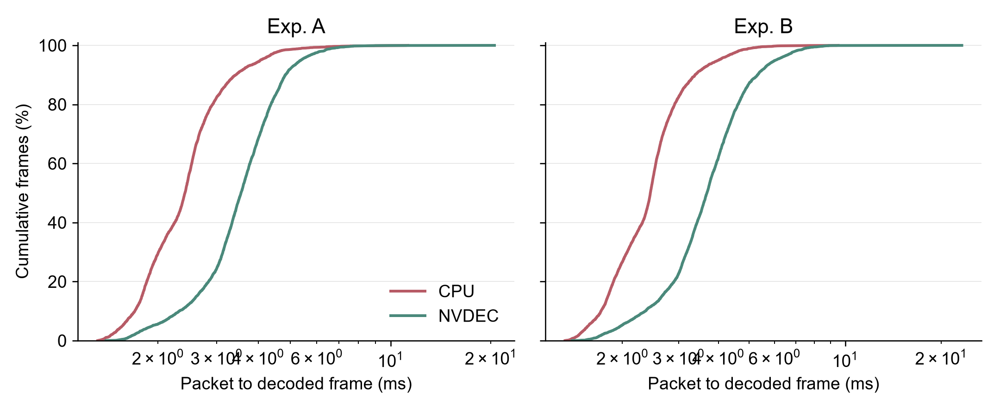

# WSL GPU 解码验证

**已通过：WSL 可实际使用 RTX 4060 Laptop GPU 的 NVDEC 和 CUDA；H.264 解码结果可直接作为 CuPy 显存视图，继续执行 CUDA 图像操作，无须先下载整图。正式微泡追踪程序未修改。**

## 测试范围与方法

- 使用已有 A、B H.264 视频，各 1320 帧、1280×1024、约 60 FPS、无 B 帧。压缩包先读入内存；两种解码器使用同样的 Annex B 压缩数据，不把读盘时间混入解码。
- CPU 使用正式环境的 PyAV 19.0.1、单解码线程；GPU 使用独立 `.venv_nvdec` 的 PyNvVideoCodec 2.2.3 / CuPy 13.6.0。CUDA toolkit 为原有 12.6，当前驱动支持 CUDA 13.4。没有安装或更换 Windows 驱动。
- CPU/GPU 每段各重复三次，交错顺序，按源视频时间逐帧送包；每次先预热 8 帧，再从第 0 帧的关键帧重新开始。启动准备另计。没有预取未来画面，没有增加正式等待区。
- 每次等待 NVDEC 和 CUDA 流确实完成再停止计时，测到的不是异步提交命令的时间。所有正式计时帧都处理，超时只记录为晚完成，不主动跳帧。
- 图像处理示例为原始亮度平面的 3×3 均值、归一化暗度、阈值；CPU/GPU 使用同样数学计算。它只用于证明显存内运算，不是正式微泡分割或追踪。
- 单独的全帧核对显式下载结果；速度测试没有完整图像下载。内存搬运观察另跑 A/B 各 120 帧，未混入速度统计。

## 解码耗时与延迟

下表从本帧压缩包开始提交，计时到其原生解码画面确实可用。CPU 结果在主内存，GPU 结果在显存；均不含后面的图像示例。

| 视频 / 路线 | 帧数 | 中位 ms | P95 ms | P99 ms | 最大 ms | >16.67 ms |
| --- | ---: | ---: | ---: | ---: | ---: | ---: |
| A_cpu | 3960 | 2.410 | 4.063 | 5.391 | 11.253 | 0 |
| A_gpu | 3960 | 3.551 | 5.376 | 6.674 | 20.494 | 1 |
| B_cpu | 3960 | 2.447 | 4.008 | 5.054 | 9.497 | 0 |
| B_gpu | 3960 | 3.682 | 6.052 | 7.503 | 23.212 | 1 |

图的横轴是完成解码的时间（对数刻度），纵轴是累计完成比例；曲线越靠左，用时越短。统计合并三轮，每轮数据仍保留在 summary.json。

**计入相同图像示例后的时间：**

| 视频 / 路线 | 送包到图像处理完成，中位 ms | P99 ms | 最大 ms | 计划时刻到完成 P99 ms | 送包晚到 P99 ms |
| --- | ---: | ---: | ---: | ---: | ---: |
| A_cpu | 4.848 | 9.301 | 17.871 | 9.303 | 0.003 |
| A_gpu | 4.409 | 8.195 | 21.812 | 8.241 | 0.023 |
| B_cpu | 4.904 | 8.229 | 16.061 | 8.230 | 0.007 |
| B_gpu | 4.570 | 9.061 | 34.594 | 9.140 | 0.008 |

以上全部使用 WSL 的同一个时钟。没有连接 RTSP、Windows 视频接收或正式追踪，因此不能把这些数值称为相机曝光到反馈的整条链路延迟。

## 像素和数据搬运核对

| 视频 | 核对帧数 | 原生 YUV 不同像素 | GPU 图像示例最大误差 | 阈值图不同像素 | 显存地址全部相同 |
| --- | ---: | ---: | ---: | ---: | --- |
| A | 1320 | 0 | 0.0 | 0 | True |
| B | 1320 | 0 | 0.0 | 0 | True |

每个 NV12 解码帧为 1,966,080 字节。DLPack/CuPy 视图与解码结果的显存地址逐帧相同，指针类型为 CUDA device memory。

CUDA 拷贝观察在 A/B 各 120 帧中分别捕捉到 240 次复制：每帧亮度 1,310,720 字节、色度 655,360 字节，**全部为显存→显存**。没有 CPU 主内存→显存或显存→主内存的图像复制，也没有无法识别方向的复制。

观察器已用已知的一次 1,310,720 字节上传和一次同尺寸下载做阳性检查，能准确记录两个方向。这里的结论是“没有整图经过 CPU 中转”，**不是 GPU 内部完全没有复制**。压缩码流仍从主内存输入解码器，驱动内部不可见操作不属于本探针完整覆盖的范围。

旧 Nsight Systems 2024.5 能记录 NVDEC 调用，但警告当前 13.4 驱动超出支持版本，缺少完整 GPU 活动记录；没有把该缺失当作零拷贝证据。最终方向核对来自 CUDA API 参数观察及阳性检查。

## 正式接入前仍需处理的限制

1. **解码模式不能直接用默认值。** 初测 `LOW` 模式仍积压 16 帧（约 267 ms）；`ZERO` 才做到每个包立即输出一帧。本轮只对已核对无 B 帧、每包一帧的 A/B 视频使用该模式，不直接推广到其他视频。
2. **当前库的 ZERO 输出时间戳不能直接使用。** 实测输出 PTS 始终为 0。测试保留原输入包的 PTS、帧号和计划时间，通过一包一帧及全帧像素顺序核对关联；不把库返回的 0 当作真实时间。正式接入仍需保留已有来源帧号和时间。
3. **NV12 的亮度不是原追踪程序的灰度。** A/B 的原始 Y 平面与当前 YUV→BGR→灰度输入平均相差约 3.69/3.74 个灰度级，最大差 12。原始 YUV 解码完全一致，但不能将这个 Y 平面直接替换正式输入，否则可能改变识别边界。
4. **现有识别与追踪仍在 CPU。** 若只换成 GPU 解码、后面继续调用当前 CPU 算法，仍需把图像下载回主内存。本轮证明的是“GPU 解码后可留在 GPU 做处理”，没有证明整套微泡分析已经 GPU 化，也没有证明先前 8–9 ms 的分析慢帧已经解决。
5. **Windows→WSL 原本就传 H.264。** 本轮可避免的是解码后的 CPU/GPU 整图往返，不是消除一条原本就在跨系统传原图的链路。

## 复现与证据

入口与依赖见工作区 README 的 GPU 解码验证小节。timing/commands.json 保存每轮实际命令；每轮 frames.csv 保存原输入时间、实际提交/完成时间及耗时。

原始资料：../verify_A_warmed/、../verify_B_warmed/；搬运资料：../copy_A_checked/、../copy_B_checked/、../copy_control.csv；早期试验失败记录保留，不计入最终性能统计。

官方接口依据：[NVIDIA 解码接口](https://docs.nvidia.com/video-technologies/pynvvideocodec/pynvc-api-reference/decoder.html)、[NVIDIA 低延迟及 CuPy 互操作说明](https://docs.nvidia.com/video-technologies/pynvvideocodec/pynvc-api-prog-guide/using_pynvvideocodec_apis.html)。本地实测与文档存在差别的地方以上文实测限制为准。
