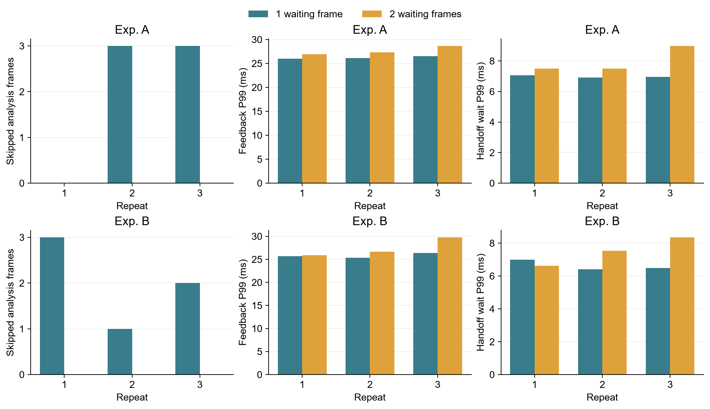

# 一帧与两帧等待区对照

A、B 各在两种设置下重复 3 次，每次 22 秒；12 组都开启上一轮相同的 Windows 同钟完成确认计时。
正式默认仍为一帧；两帧只通过 `--waiting-frames 2` 显式启用。

## 本轮判断

两帧方案没有同时达到全部比较标准；保留单帧默认。应结合下面的逐视频结果，区分改善、代价和证据不足。

预先写入 test_plan.json 的标准：每段视频合计跳帧至少减少一半；反馈 P95/P99 各增加不超过 2 ms；交接等待 P99 不超过一帧约 16.7 ms。这是本次工程比较标准，不是曝光或设备控制的安全期限。

## 三次合计

| 视频 | 等待帧数 | 录像/解码 | 分析/保存 | 跳帧 | 反馈中位数 | P95 | P99 | 最大 | 等待 P99 | 等待最大 |
| --- | ---: | ---: | ---: | ---: | ---: | ---: | ---: | ---: | ---: | ---: |
| A | 1 | 3960 | 3954 | 6 | 14.037 | 23.776 | 26.186 | 38.634 | 6.990 | 13.450 |
| A | 2 | 3960 | 3960 | 0 | 14.149 | 24.084 | 27.513 | 48.187 | 7.775 | 24.632 |
| B | 1 | 3960 | 3954 | 6 | 13.895 | 23.292 | 25.740 | 41.211 | 6.568 | 11.115 |
| B | 2 | 3960 | 3960 | 0 | 13.994 | 23.745 | 27.888 | 45.858 | 7.686 | 22.617 |

时间单位均为 ms；合计分位数由全部逐帧记录重新计算，不是对三组 P99 取平均。跳过的帧不伪造分析完成确认。

- A：跳帧减少 100.0%；反馈 P95 改变 +0.308 ms，P99 +1.327 ms，最大值 +9.553 ms。
  交接等待超过一帧时长的画面由 0 帧变为 4 帧；最长等待由 13.450 ms 变为 24.632 ms。
- B：跳帧减少 100.0%；反馈 P95 改变 +0.453 ms，P99 +2.148 ms，最大值 +4.647 ms。
  交接等待超过一帧时长的画面由 0 帧变为 1 帧；最长等待由 11.115 ms 变为 22.617 ms。

## 每次结果

| 运行 | 跳帧 | 反馈 P95 | 反馈 P99 | 反馈最大 | 等待 P99 | 反馈超过 50 ms | 等待超过一帧 |
| --- | ---: | ---: | ---: | ---: | ---: | ---: | ---: |
| A_q1_r1 | 0 | 23.638 | 25.973 | 35.820 | 7.066 | 0 | 0 |
| A_q2_r1 | 0 | 23.940 | 26.909 | 36.587 | 7.503 | 0 | 0 |
| B_q1_r1 | 3 | 22.977 | 25.658 | 34.991 | 6.996 | 0 | 0 |
| B_q2_r1 | 0 | 22.839 | 25.864 | 30.983 | 6.633 | 0 | 0 |
| A_q2_r2 | 0 | 24.010 | 27.330 | 32.630 | 7.503 | 0 | 0 |
| A_q1_r2 | 3 | 24.027 | 26.104 | 32.842 | 6.910 | 0 | 0 |
| B_q2_r2 | 0 | 23.571 | 26.687 | 38.645 | 7.531 | 0 | 0 |
| B_q1_r2 | 1 | 23.501 | 25.332 | 29.949 | 6.413 | 0 | 0 |
| A_q1_r3 | 3 | 23.614 | 26.553 | 38.634 | 6.962 | 0 | 0 |
| A_q2_r3 | 0 | 24.211 | 28.662 | 48.187 | 8.985 | 0 | 4 |
| B_q1_r3 | 2 | 23.368 | 26.346 | 41.211 | 6.496 | 0 | 0 |
| B_q2_r3 | 0 | 24.659 | 29.782 | 45.858 | 8.356 | 0 | 1 |

图中每行对应一段视频，每列依次比较跳帧数、反馈 P99、交接等待 P99。蓝色是一帧等待，黄色是两帧；横轴为第几次重复。完整数字在 runs.csv。

## 如何保证没有以错误结果换取速度

- 等待区按先来先处理；满时仅替换最旧的待取帧。正在分析和正在写入的空间各自独占；一帧方案共 3 块，两帧方案共 4 块。
- 多一块 1280×1024 灰度图及帧头，预分配空间约增加 1.31 MiB；实际进程峰值内存在 runs.csv，不能把两个进程的共享驻留内存简单相加。
- 每次替换保存被跳过帧号、替换它的新帧号及 WSL 时间；逐一核对所有分析跳帧。等待数量没有超过限制，正常结束等待区全部排空。
- 12 组录像均逐帧核对原 A/B 视频循环中的像素；每组所有实际分析帧重新离线计算，核对轮廓、编号、运动、事件和源时间记录。数据库与确认消息均核对帧数；详细证据在 ../integrity_report/ 和各组 equivalence.json。
- 两种设置可能实际分析不同的帧，也可能从视频不同位置接入，因此不能要求两次独立运行的编号完全相同。核对的是各自相同输入下的结果，不把正常的输入差异误判成算法改变。

## 计时边界及限制

完整反馈：Windows 在 H.264 拆包解析后、分流前记录收到帧，到 Windows 收到同一帧的分析完成确认。两点使用同一个 Windows 时钟。
交接等待：WSL 完成共享内存复制、准备发布，到开始分析；包含发布、唤醒、排队及取帧。只相减 WSL 本机时间。
这些值不包含相机曝光、前端 RTSP 接收缓冲，也不包含数据库最终全部写盘和 AFG 动作。分析完成是已计算并提交保存，实验结束另核对全部保存完成。
短测没有建立无限期的低延迟保证；两帧空间只应对短时成批到达，不能解决处理速度长期低于输入速度。极端停顿仍可造成旧帧或替换。
各组是独立回放，帧到达起伏和系统调度也会影响尾部；这些是本次观测差异，不能把每一次最慢反馈的变化全部归因于等待区容量。
模拟视频循环只是负载测试，不是新实验。所有采集完成后才做离线重算，不用重算任务干扰计时；giolibproxy.dll 警告只记录，不修改 Windows 环境。
